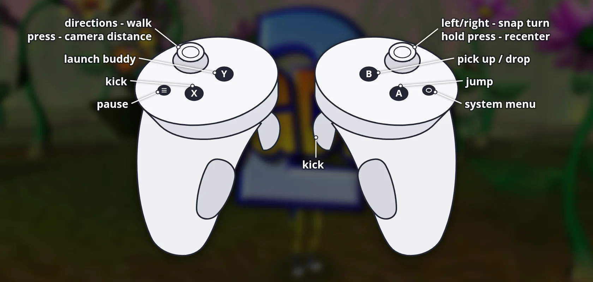

# Bugdom 2 VR (Meta Quest / PICO) - Beta

**Download, install guide, controls and pictures: [portroyale.online/bugdom2.html](https://portroyale.online/bugdom2.html)**

Unofficial standalone-VR build of [Bugdom 2](https://github.com/jorio/Bugdom2) (Pangea Software 2002,
modern port by Iliyas Jorio), running natively on Android-based headsets via OpenXR.

## Status

- Meta Quest 3: tested.
- Meta Quest 2 / Pro / 3S: should work (same runtime), not tested.
- PICO 4 / Neo 3: built in (PICO controller bindings, OpenXR launcher category), **not tested yet**.

## Install (sideload)

1. Enable developer mode on the headset and connect it via USB.
2. `adb install -r Bugdom2-VR-4.0.1-beta1.apk`
3. Quest: App Library -> filter "Unknown Sources" -> Bugdom 2.
   PICO: Library -> Unknown sources -> Bugdom 2.

The first start takes a little longer: the game data (about 180 MB) is unpacked once.

## Controls

| Controller | In game | In menus |
|---|---|---|
| Left stick | Walk | Move through the menu |
| Right stick left / right | Snap turn (30 deg) | - |
| Hold right stick click 1 s | Recenter view (forward + eye height) | Recenter |
| A | Jump | Confirm |
| B | Pick up / drop | Back |
| X or right trigger | Kick | - |
| Y | Launch buddy | - |
| Left stick click | Camera distance | - |
| Grip left / right | - | Previous / next |
| Menu button | Pause | - |

## VR features

- Stereo 3D with head tracking and a chase camera that keeps the horizon level; 30 deg snap turns.
- Tunnel rides, the balsa plane and the level intros follow the game camera, horizon kept level.
- HUD on a floating panel, with the info bars at the top and bottom edges of your view.
- Automatic recenter on start, plus manual recenter.
- Fades are done by the headset compositor; correct sRGB colors.

## Build

Requires Android SDK + NDK 27.2.12479018 and SDL3 source in `extern/SDL`:

    git submodule update --init
    git clone --depth 1 --branch release-3.4.x https://github.com/libsdl-org/SDL extern/SDL
    cd android
    ./gradlew assembleRelease

Output: `android/app/build/outputs/apk/release/app-release.apk` (signed with the debug key, sideload only).

On desktop Linux, `cmake -DGLES_TEST=ON` builds the game through the same OpenGL ES emulation layer
the headset uses (`GLC_TEST_LEVEL=0..9` jumps into a level, `GLC_SNAPSHOT_FRAMES=...` saves frames to /tmp).

## License

Same as upstream Bugdom 2: CC BY-NC-SA 4.0. Non-commercial; derivatives must use the same license.
